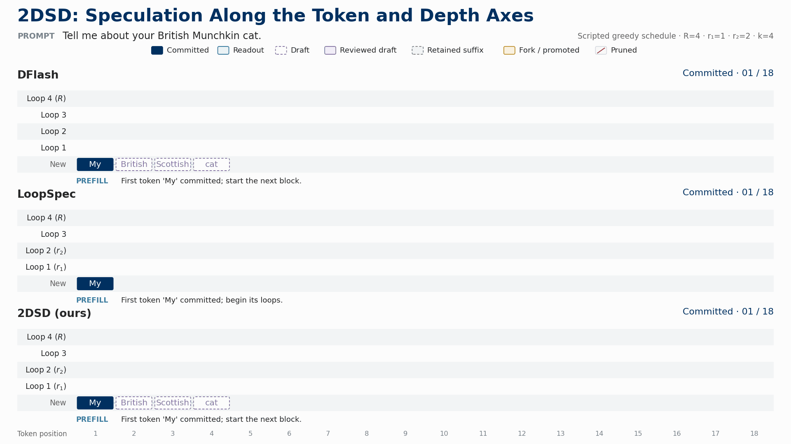

<div align="center">

# 2DSD: Two-Dimensional Speculative Decoding for Looped Language Models



[**Minseo Kim**](https://minseokim.org/)<sup>1</sup>\* · [**Arnav Chavan**](https://arnav0400.github.io/)<sup>1</sup>\* · [**Minhyuk Seo**](https://dbd05088.github.io/)<sup>1</sup> · [**Yuezhou Hu**](https://yuezhouhu.github.io/)<sup>1</sup> · [**Minjae Lee**](https://mjbooo.github.io/)<sup>2</sup><br>
[**Wonjun Kang**](https://wonjunn.github.io/)<sup>2</sup> · [**Michael W. Mahoney**](https://www.stat.berkeley.edu/~mmahoney/)<sup>1,3,4</sup> · [**Kurt Keutzer**](https://keutzer.github.io/)<sup>1</sup> · [**Coleman Hooper**](https://colemanhooper.org/)<sup>1</sup>† · [**Amir Gholami**](https://amirgholami.org/)<sup>1,3</sup>†

<sup>1</sup>University of California, Berkeley &nbsp;&nbsp; <sup>2</sup>FuriosaAI &nbsp;&nbsp; <sup>3</sup>ICSI &nbsp;&nbsp; <sup>4</sup>LBNL

<sup>\*</sup>Equal contribution &nbsp;&nbsp; <sup>†</sup>Equal advising


[](paper/2DSD.pdf)
[](https://huggingface.co/collections/minseo25/2dsd-6afb8af3e28a6edb66fa4434)

</div>

## 🔔 Updates

- **Nov 19, 2026** Code, shared-KV targets and drafters released.

## 🔍 Overview

Looped language models (LMs) increase effective depth without increasing parameter count, but decoding latency and KV cache memory scale linearly with the number of loops. Speculative Decoding (SD) drafts tokens cheaply along the token dimension and verifies them in parallel using the target LM. Looped LMs, however, expose two axes of speculation, tokens and depth. We exploit this fact and propose **2DSD**, a two-dimensional SD method designed for looped LMs. It combines block drafting at early-loop readouts with overlapping loop execution while preserving the model's greedy outputs and sampling distribution. To further improve throughput, we integrate last-loop KV cache sharing to reduce KV cache read traffic, applying lightweight self-distillation where needed to maintain model quality. Across different looped LMs, 2DSD achieves geometric mean throughput speedups of up to 7.6× for greedy decoding and 5.5× for sampling over native AR. 2DSD sustains speculation gains at long context and across hardware platforms, and reduces KV cache storage while preserving model quality. Overall, 2DSD solves two critical issues in looped LMs (KV cache memory and low throughput) and makes effective-depth scaling at a fixed parameter count practical for inference.


*Four stages of 2DSD (illustrative R = 4, r<sub>1</sub> = 1, r<sub>2</sub> = 2, k = 4): (a) block drafting after prefill; (b) at loop r<sub>1</sub>, drafts are reviewed in order, resampling at the first rejection to continue drafting; (c) disagreement between the loop-r<sub>2</sub> argmax and the early-loop candidate opens the gate to fork an alternative continuation, while r<sub>1</sub> review and drafting continue; (d) candidates are verified using the preceding token's last-loop distribution, committing accepted tokens and pruning alternative branches.*

## ⚙️ Installation

- **Requirements:** Linux x86_64, Python 3.12, an NVIDIA GPU with BF16 support, an NVIDIA driver that supports
  CUDA 13.0, and [uv](https://docs.astral.sh/uv/).
- **Tested on:** NVIDIA H100 (FlashAttention 3), L40S and A100 (FlashAttention 2).

```bash
git clone https://github.com/SqueezeAILab/2DSD.git && cd 2DSD
uv sync --locked --no-editable
source .venv/bin/activate
```

## 🤗 Models

| Base model | Loops R | Shared-KV target (W = 64) | Drafter for the shared-KV target (2DSD) | Drafter for the base model (2DSD without sharing) |
|---|---:|---|---|---|
| [Ouro-1.4B-Thinking](https://huggingface.co/ByteDance/Ouro-1.4B-Thinking) | 4 | [2dsd-ouro-1.4b-thinking-shared-kv](https://huggingface.co/minseo25/2dsd-ouro-1.4b-thinking-shared-kv) | [2dsd-ouro-1.4b-thinking-shared-kv-dflash-drafter](https://huggingface.co/minseo25/2dsd-ouro-1.4b-thinking-shared-kv-dflash-drafter) | [2dsd-ouro-1.4b-thinking-dflash-drafter](https://huggingface.co/minseo25/2dsd-ouro-1.4b-thinking-dflash-drafter) |
| [Ouro-2.6B-Thinking](https://huggingface.co/ByteDance/Ouro-2.6B-Thinking) | 4 | [2dsd-ouro-2.6b-thinking-shared-kv](https://huggingface.co/minseo25/2dsd-ouro-2.6b-thinking-shared-kv) | [2dsd-ouro-2.6b-thinking-shared-kv-dflash-drafter](https://huggingface.co/minseo25/2dsd-ouro-2.6b-thinking-shared-kv-dflash-drafter) | [2dsd-ouro-2.6b-thinking-dflash-drafter](https://huggingface.co/minseo25/2dsd-ouro-2.6b-thinking-dflash-drafter) |
| [Nanbeige4.2-3B](https://huggingface.co/Nanbeige/Nanbeige4.2-3B) | 2 | [2dsd-nanbeige4.2-3b-shared-kv](https://huggingface.co/minseo25/2dsd-nanbeige4.2-3b-shared-kv) | [2dsd-nanbeige4.2-3b-shared-kv-dflash-drafter](https://huggingface.co/minseo25/2dsd-nanbeige4.2-3b-shared-kv-dflash-drafter) | [2dsd-nanbeige4.2-3b-dflash-drafter](https://huggingface.co/minseo25/2dsd-nanbeige4.2-3b-dflash-drafter) |
| [Dory1.0-4B](https://huggingface.co/nvidia/NVIDIA-Nemotron-Labs-Dory1.0-4B-BF16) | 4 | the base checkpoint with last-loop KV sharing (no adaptation) | [2dsd-dory1.0-4b-dflash-drafter](https://huggingface.co/minseo25/2dsd-dory1.0-4b-dflash-drafter) | the same drafter |

- **Ouro and Nanbeige:** last-loop KV sharing runs on the adapted shared-KV targets, whose `config.json` sets it
  (`loopedtf_kv_policy`, `loopedtf_kv_window`), and per-loop KV on the base models.
- **Dory1.0-4B:** there is no adapted checkpoint. 2DSD runs the base checkpoint with R = 4, either with last-loop
  KV sharing on its full-attention layers, applied without adaptation, or with per-loop KV.

`configs/models.json` lists these repositories and pins the base models' revisions.

## 🚀 Quick start

```bash
python scripts/generate.py --model ouro-2.6b-thinking --prompt "What is the sum of the first 100 positive integers?"
```

`--model` also takes `ouro-1.4b-thinking`, `nanbeige4.2-3b` and `dory1.0-4b`. It runs 2DSD with last-loop KV
sharing by default; `--target original` runs 2DSD on the base model with per-loop KV (no KV sharing).

From Python:

```python
from vllm.v1.spec_decode.twodsd import TwoDSD

engine = TwoDSD("minseo25/2dsd-ouro-2.6b-thinking-shared-kv",
                drafter="minseo25/2dsd-ouro-2.6b-thinking-shared-kv-dflash-drafter", max_model_len=8192)
messages = [{"role": "user", "content": "What is the sum of the first 100 positive integers?"}]
text = engine.tokenizer.apply_chat_template(messages, tokenize=False, add_generation_prompt=True)
prompt_ids = engine.tokenizer.encode(text, add_special_tokens=False)
[result] = engine.generate([prompt_ids])  # greedy; pass temperature=0.6, top_p=0.95 to sample
print((len(result["output_ids"]) - 1) / result["decode_seconds"], "tok/s")
del engine  # shuts the vLLM engine down
```

`TwoDSD` defaults to the paper's configuration with block size k = 16: early drafting at r1 = 1 and deeper
branching (promotion and forking) at r2 = 2 on Ouro and Dory (R = 4), and early-only drafting at r1 = 1 on
Nanbeige (R = 2).

## 📊 Reproducing the throughput evaluation

```bash
# 1. Prompts. Core: GSM8K, MATH-500, HumanEval+, MBPP+ at 8K. Hard (--suite hard): AIME24/25, GPQA-Diamond,
#    OlympiadBench at 32K. GPQA is gated: accept its terms on Hugging Face and log in before building Hard.
python scripts/build_prompts.py --model ouro-2.6b-thinking --suite core --out prompts/ouro-2.6b

# 2. 2DSD and the native AR reference (--target original), one GPU each (resumable).
python scripts/benchmark.py --model ouro-2.6b-thinking \
    --prompts prompts/ouro-2.6b/core.prompts.jsonl --out runs/ouro-2.6b-core-2dsd.jsonl
python scripts/benchmark.py --method ar --model ouro-2.6b-thinking --target original \
    --prompts prompts/ouro-2.6b/core.prompts.jsonl --out runs/ouro-2.6b-core-ar-native.jsonl
#    Sharing ablation (Table 4): 2DSD without KV sharing, on the base model with per-loop KV.
python scripts/benchmark.py --model ouro-2.6b-thinking --target original \
    --prompts prompts/ouro-2.6b/core.prompts.jsonl --out runs/ouro-2.6b-core-2dsd-no-sharing.jsonl

# 3. Decode throughput per benchmark, over all responses and repetition-filtered.
python scripts/benchmark.py --summarize runs/ouro-2.6b-core-*.jsonl
```

The same commands run every model. Notes:

- Sampling uses `--temperature 0.6 --top-p 0.95`.
- Decode throughput counts the tokens after the first one over the decode time, excluding prefill and including
  drafting and verification.
- The paper's main tables exclude capped responses whose final 2048 tokens have fewer than half distinct 16-grams
  (the repetition-filtered column).
- Every committed token is verified against the final loop, so decoding preserves the served model's original
  distribution.

## 🏋️ Training

Both recipes are in [`training/README.md`](training/README.md):

- **Shared-KV adaptation** (App. C): one epoch of two-pass self-distillation on 128M tokens, about 3.4–6.7 hours
  on four H100 GPUs per model (Ouro and Nanbeige; Dory1.0-4B shares without adaptation).
- **Depth-conditioned DFlash drafter** (App. D.4): target rollouts on 13K prompts, then six epochs of DFlash
  training across loop depths, for all four models.

## 📂 Repository contents

| Path | Contents |
|---|---|
| `vllm-fork/` | vLLM v0.26.0 with the 2DSD executor and last-loop KV sharing for Ouro, Nanbeige and Dory |
| `training/kd/`, `training/sharekv/` | Shared-KV adaptation by two-pass self-distillation (App. C) |
| `training/drafter/` | Depth-conditioned DFlash drafter: prompt pool, target rollouts, training, export (App. D.4) |
| `training/hf_models/` | Transformers ports of Ouro and Nanbeige and a plain PyTorch implementation of Dory1.0-4B, used in training |
| `scripts/` | `generate.py` (quick start), `benchmark.py` (decode throughput), `build_prompts.py` (benchmark prompts); `--help` lists the overrides of the registry's models |
| `configs/` | Model registry, benchmark sources and training recipes |
| `tests/` | `python -m pytest tests` runs the CPU tests (scheduler, losslessness, runners, training); `TWODSD_CUDA_TESTS=1` adds the CUDA kernel and graph tests (one GPU) |

## 🙏 Acknowledgments

2DSD builds on these projects and models; we thank their authors and communities:

- [vLLM](https://github.com/vllm-project/vllm) and [Speculators](https://github.com/vllm-project/speculators)
- Ouro ([1.4B-Thinking](https://huggingface.co/ByteDance/Ouro-1.4B-Thinking), [2.6B-Thinking](https://huggingface.co/ByteDance/Ouro-2.6B-Thinking)), [Nanbeige4.2-3B](https://huggingface.co/Nanbeige/Nanbeige4.2-3B) and [Dory1.0-4B](https://huggingface.co/nvidia/NVIDIA-Nemotron-Labs-Dory1.0-4B-BF16)

## 📝 Citation

If you find 2DSD useful, please consider citing:

```bibtex
@misc{kim2026twodsd,
  title  = {2DSD: Two-Dimensional Speculative Decoding for Looped Language Models},
  author = {Kim, Minseo and Chavan, Arnav and Seo, Minhyuk and Hu, Yuezhou and Lee, Minjae and
            Kang, Wonjun and Mahoney, Michael W. and Keutzer, Kurt and Hooper, Coleman and Gholami, Amir},
  year   = {2026},
  url    = {https://github.com/SqueezeAILab/2DSD}
}
```

## 📜 License

Apache License 2.0 (see `LICENSE`). `vllm-fork/` is derived from vLLM (Apache 2.0). The released
weights carry their licenses on their model cards: Apache 2.0 for the Ouro and Nanbeige targets and drafters, and
the OpenMDW License 1.1 for the Dory1.0-4B drafter.
