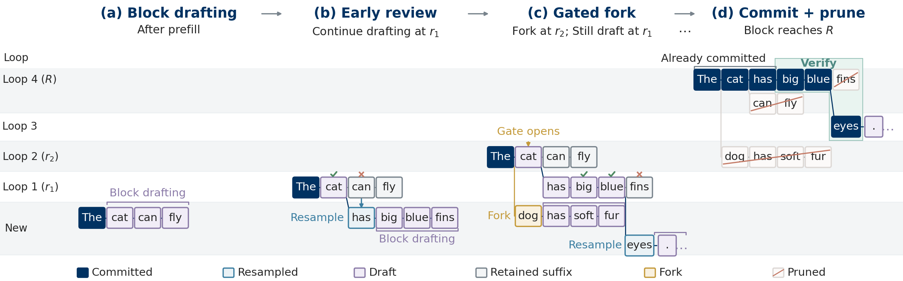

<div align="center">

# 2DSD: Two-Dimensional Speculative Decoding for Looped Language Models


[Minseo Kim](https://minseokim.org/)<sup>1</sup>\* · [Arnav Chavan](https://arnav0400.github.io/)<sup>1</sup>\* · [Minhyuk Seo](https://dbd05088.github.io/)<sup>1</sup> · [Yuezhou Hu](https://yuezhouhu.github.io/)<sup>1</sup> · [Minjae Lee](https://mjbooo.github.io/)<sup>2</sup><br>
[Wonjun Kang](https://wonjunn.github.io/)<sup>2</sup> · [Michael W. Mahoney](https://www.stat.berkeley.edu/~mmahoney/)<sup>1,3,4</sup> · [Kurt Keutzer](https://keutzer.github.io/)<sup>1</sup> · [Coleman Hooper](https://colemanhooper.org/)<sup>1</sup>† · [Amir Gholami](https://amirgholami.org/)<sup>1,3</sup>†

<sup>1</sup>University of California, Berkeley &nbsp;&nbsp; <sup>2</sup>FuriosaAI &nbsp;&nbsp; <sup>3</sup>ICSI &nbsp;&nbsp; <sup>4</sup>LBNL

<sup>\*</sup>Equal contribution &nbsp;&nbsp; <sup>†</sup>Equal advising

[Paper](paper/2DSD.pdf) · [Models](https://huggingface.co/collections/minseo25/2dsd-6afb8af3e28a6edb66fa4434)

</div>

## Updates

- Nov 23, 2026: Inkling-2-Mini (variable-loop) and DSpark drafters supported.
- Nov 19, 2026: Code, shared-KV targets and drafters released.

## Overview

2DSD accelerates looped language models by speculating across tokens and loop depth. It combines block drafting at early-loop readouts with overlapping loop execution. Final-loop verification preserves the served target's greedy outputs and sampling distribution. Last-loop KV cache sharing reduces cache storage and read traffic, with self-distillation where adaptation is needed.

The paper reports geometric mean throughput speedups of up to 7.6× for greedy decoding and 5.5× for sampling over native autoregressive (AR) decoding.



*Four stages of 2DSD (illustrative R = 4, r<sub>1</sub> = 1, r<sub>2</sub> = 2, k = 4): (a) block drafting after prefill; (b) at loop r<sub>1</sub>, drafts are reviewed in order, resampling at the first rejection to continue drafting; (c) disagreement between the loop-r<sub>2</sub> argmax and the early-loop candidate opens the gate to fork an alternative continuation, while r<sub>1</sub> review and drafting continue; (d) candidates are verified using the preceding token's last-loop distribution, committing accepted tokens and pruning alternative branches.*

## Installation

- **Requirements:** Linux x86_64, Python 3.12, an NVIDIA GPU with BF16 support, an NVIDIA driver that supports
  CUDA 13.0, and [uv](https://docs.astral.sh/uv/).
- **Tested on:** NVIDIA H100 (FlashAttention 3), L40S and A100 (FlashAttention 2).

```bash
git clone https://github.com/SqueezeAILab/2DSD.git && cd 2DSD
uv sync --locked --no-editable
source .venv/bin/activate
```

## Models

| Base model | Loops (R) | Shared-KV target (W = 64) | Shared-KV drafter | Base-model drafter |
|---|---:|---|---|---|
| [Ouro-1.4B-Thinking](https://huggingface.co/ByteDance/Ouro-1.4B-Thinking) | 4 | [Target](https://huggingface.co/minseo25/2dsd-ouro-1.4b-thinking-shared-kv) | [Drafter](https://huggingface.co/minseo25/2dsd-ouro-1.4b-thinking-shared-kv-dflash-drafter) | [Drafter](https://huggingface.co/minseo25/2dsd-ouro-1.4b-thinking-dflash-drafter) |
| [Ouro-2.6B-Thinking](https://huggingface.co/ByteDance/Ouro-2.6B-Thinking) | 4 | [Target](https://huggingface.co/minseo25/2dsd-ouro-2.6b-thinking-shared-kv) | [Drafter](https://huggingface.co/minseo25/2dsd-ouro-2.6b-thinking-shared-kv-dflash-drafter) | [Drafter](https://huggingface.co/minseo25/2dsd-ouro-2.6b-thinking-dflash-drafter) |
| [Nanbeige4.2-3B](https://huggingface.co/Nanbeige/Nanbeige4.2-3B) | 2 | [Target](https://huggingface.co/minseo25/2dsd-nanbeige4.2-3b-shared-kv) | [Drafter](https://huggingface.co/minseo25/2dsd-nanbeige4.2-3b-shared-kv-dflash-drafter) | [Drafter](https://huggingface.co/minseo25/2dsd-nanbeige4.2-3b-dflash-drafter) |
| [Dory1.0-4B](https://huggingface.co/nvidia/NVIDIA-Nemotron-Labs-Dory1.0-4B-BF16) | 4 | Base checkpoint; no adaptation | [Drafter](https://huggingface.co/minseo25/2dsd-dory1.0-4b-dflash-drafter) | Same drafter |

- **Ouro and Nanbeige:** adapted shared-KV targets enable last-loop sharing through `loopedtf_kv_policy` and
  `loopedtf_kv_window` in `config.json`. Base models use per-loop KV caches.
- **Dory1.0-4B:** uses the base checkpoint without adaptation, with R = 4 and either last-loop KV sharing
  on full-attention layers or per-loop KV caches. Both modes use the same drafter.

[`configs/models.json`](configs/models.json) lists the repositories and pins base-model revisions.

## Quick start

```bash
python scripts/generate.py --model ouro-2.6b-thinking --prompt "What is the sum of the first 100 positive integers?"
```

Other `--model` values are `ouro-1.4b-thinking`, `nanbeige4.2-3b` and `dory1.0-4b`. Last-loop KV sharing is
enabled by default. Use `--target original` to run the base model with per-loop KV caches.

From Python:

```python
from vllm.v1.spec_decode.twodsd import TwoDSD

engine = TwoDSD(
    "minseo25/2dsd-ouro-2.6b-thinking-shared-kv",
    drafter="minseo25/2dsd-ouro-2.6b-thinking-shared-kv-dflash-drafter",
    max_model_len=8192,
)
messages = [{"role": "user", "content": "What is the sum of the first 100 positive integers?"}]
text = engine.tokenizer.apply_chat_template(messages, tokenize=False, add_generation_prompt=True)
prompt_ids = engine.tokenizer.encode(text, add_special_tokens=False)
[result] = engine.generate([prompt_ids])  # greedy; pass temperature=0.6, top_p=0.95 to sample
print((len(result["output_ids"]) - 1) / result["decode_seconds"], "tok/s")
del engine  # Shut down the vLLM engine.
```

`TwoDSD` defaults to the paper's configuration with block size k = 16: early drafting at r1 = 1 and deeper
branching (promotion and forking) at r2 = 2 on Ouro and Dory (R = 4), and early-only drafting at r1 = 1 on
Nanbeige (R = 2).

## Throughput evaluation

The core suite covers GSM8K, MATH-500, HumanEval+ and MBPP+ with an 8K total token budget (prompt + output).
Use `--suite hard` for AIME24/25, GPQA-Diamond and OlympiadBench with a 32K budget. GPQA requires accepting
its terms on Hugging Face and logging in before building the hard suite.

Each benchmark run uses one GPU and supports resuming.

```bash
# Build prompts.
python scripts/build_prompts.py --model ouro-2.6b-thinking --suite core --out prompts/ouro-2.6b

# Run 2DSD and the native AR reference.
python scripts/benchmark.py --model ouro-2.6b-thinking \
    --prompts prompts/ouro-2.6b/core.prompts.jsonl --out runs/ouro-2.6b-core-2dsd.jsonl
python scripts/benchmark.py --method ar --model ouro-2.6b-thinking --target original \
    --prompts prompts/ouro-2.6b/core.prompts.jsonl --out runs/ouro-2.6b-core-ar-native.jsonl

# Run 2DSD without KV sharing (Table 4 ablation).
python scripts/benchmark.py --model ouro-2.6b-thinking --target original \
    --prompts prompts/ouro-2.6b/core.prompts.jsonl --out runs/ouro-2.6b-core-2dsd-no-sharing.jsonl

# Summarize throughput over all responses and with repetition filtering.
python scripts/benchmark.py --summarize runs/ouro-2.6b-core-*.jsonl
```

Use the same commands with any supported `--model`.

- For sampling, add `--temperature 0.6 --top-p 0.95`.
- Decode throughput is tokens after the first token divided by decode time. It excludes prefill and includes
  drafting and verification.
- The paper's main tables exclude capped responses whose final 2048 tokens have fewer than half distinct 16-grams
  (the repetition-filtered column).

## Inkling 2

We support the variable-loop checkpoint of [Inkling-2-Mini](https://huggingface.co/thinkingmachines/Inkling-2-Mini),
[TML-d24-varloop-research](https://huggingface.co/thinkingmachines/TML-d24-varloop-research)
(`inkling-2-mini-varloop`), with its
[DSpark drafter](https://huggingface.co/minseo25/2dsd-inkling-2-mini-varloop-dspark-drafter):

```bash
# Packed expert kernels of the default path (the locked environment has an older Humming).
uv pip install --target humming-0.1.20 --no-deps humming-kernels==0.1.20

python scripts/build_prompts.py --model inkling-2-mini-varloop --suite core --out prompts/inkling-varloop
python scripts/benchmark.py --model inkling-2-mini-varloop --humming humming-0.1.20 \
    --prompts prompts/inkling-varloop/core.prompts.jsonl --out runs/inkling-varloop-core-2dsd.jsonl
python scripts/benchmark.py --method ar --model inkling-2-mini-varloop --humming humming-0.1.20 \
    --prompts prompts/inkling-varloop/core.prompts.jsonl --out runs/inkling-varloop-core-ar.jsonl
python scripts/benchmark.py --summarize runs/inkling-varloop-core-2dsd.jsonl runs/inkling-varloop-core-ar.jsonl
```

## Training

See [`training/README.md`](training/README.md) for both recipes:

- **Shared-KV adaptation** (App. C): one epoch of two-pass self-distillation on 128M tokens, about 3.4–6.7 hours
  on four H100 GPUs per model (Ouro and Nanbeige; Dory1.0-4B shares without adaptation).
- **Depth-conditioned DFlash drafter** (App. D.4): target rollouts on 13K prompts, then six epochs of DFlash
  training across loop depths, for all four models.
- **DSpark drafter**: the same pipeline with the `dspark` recipe, used for Inkling 2.

## Repository contents

| Path | Contents |
|---|---|
| `vllm-fork/` | vLLM v0.26.0 with the 2DSD executor, last-loop KV sharing for Ouro, Nanbeige and Dory, and the Inkling 2 runner |
| `training/kd/`, `training/sharekv/` | Shared-KV adaptation by two-pass self-distillation (App. C) |
| `training/drafter/` | Depth-conditioned DFlash drafter: prompt pool, target rollouts, training, export (App. D.4) |
| `training/hf_models/` | Transformers ports of Ouro and Nanbeige and a plain PyTorch implementation of Dory1.0-4B, used in training |
| `scripts/` | Generation, throughput benchmarks and prompt construction; `--help` lists model overrides |
| `configs/` | Model registry, benchmark sources and training recipes |
| `tests/` | `python -m pytest tests` runs the CPU tests (scheduler, losslessness, runners, training); `TWODSD_CUDA_TESTS=1` adds the CUDA kernel and graph tests (one GPU) |

## Acknowledgments

2DSD builds on the following projects and models:

- [vLLM](https://github.com/vllm-project/vllm) and [Speculators](https://github.com/vllm-project/speculators)
- Ouro ([1.4B-Thinking](https://huggingface.co/ByteDance/Ouro-1.4B-Thinking), [2.6B-Thinking](https://huggingface.co/ByteDance/Ouro-2.6B-Thinking)), [Nanbeige4.2-3B](https://huggingface.co/Nanbeige/Nanbeige4.2-3B) and [Dory1.0-4B](https://huggingface.co/nvidia/NVIDIA-Nemotron-Labs-Dory1.0-4B-BF16)

## Citation

```bibtex
@misc{kim2026twodsd,
  title  = {2DSD: Two-Dimensional Speculative Decoding for Looped Language Models},
  author = {Kim, Minseo and Chavan, Arnav and Seo, Minhyuk and Hu, Yuezhou and Lee, Minjae and
            Kang, Wonjun and Mahoney, Michael W. and Keutzer, Kurt and Hooper, Coleman and Gholami, Amir},
  year   = {2026},
  url    = {https://github.com/SqueezeAILab/2DSD}
}
```

## License

The code is licensed under [Apache License 2.0](LICENSE). `vllm-fork/` is derived from vLLM (Apache 2.0).
Released weights use the licenses specified in their model cards: Apache 2.0 for the Ouro and Nanbeige
targets and drafters, and OpenMDW License 1.1 for the Dory1.0-4B drafter.
